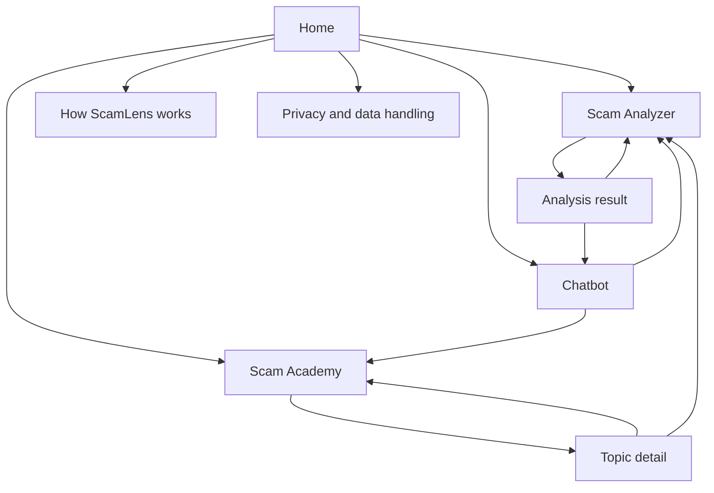
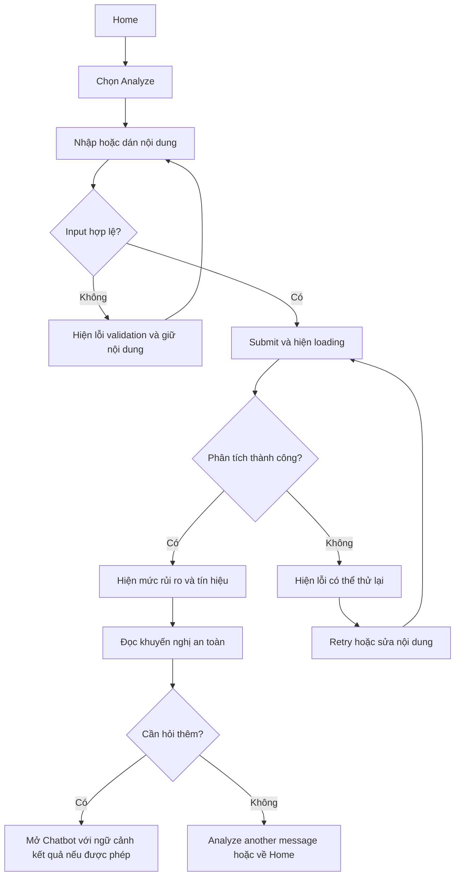

# ScamLens VN — Sitemap và User Flow

- **Owner:** `thanhhuong107` — Sitemap & User Flow
- **Trạng thái:** Bản đề xuất để Frontend team review trước khi chuyển sang Figma/FigJam.
- **Phạm vi:** Home, Scam Analyzer, Chatbot, Scam Academy và các trạng thái loading/error cơ bản.
- **Lưu ý:** Đây là information architecture và luồng sản phẩm đề xuất, chưa phải feature đã triển khai hay UI đã được phê duyệt.

## 1. Mục tiêu người dùng

Giúp người dùng tại Việt Nam kiểm tra nội dung đáng ngờ, hiểu vì sao nội dung có rủi ro, biết bước xử lý an toàn tiếp theo và tự học cách nhận biết lừa đảo. Trải nghiệm cần dẫn người dùng từ **nhập nội dung → phân tích → xem kết quả → nhận tư vấn** mà không hứa hẹn khả năng phát hiện chính xác tuyệt đối.

## 2. Sitemap

### Page purpose and key content

| Page / area                    | Purpose                                         | Main content and actions                                                                                                                                                                                                          |
| ------------------------------ | ----------------------------------------------- | --------------------------------------------------------------------------------------------------------------------------------------------------------------------------------------------------------------------------------- |
| **Home**                       | Giải thích sản phẩm và giúp chọn việc cần làm   | Headline ngắn; CTA chính **Analyze a suspicious message**; CTA phụ mở Chatbot và Scam Academy; ví dụ nội dung có thể phân tích; giải thích giới hạn kết quả; liên kết cách hoạt động và quyền riêng tư.                           |
| **Scam Analyzer**              | Nhận nội dung người dùng muốn kiểm tra          | Text area để dán/nhập tin nhắn hoặc nội dung đáng ngờ; hướng dẫn không nhập thông tin bí mật của bản thân; nút **Analyze**; validation và giới hạn nhập liệu sẽ được chốt theo API.                                               |
| **Analysis result**            | Giúp hiểu kết quả và chọn bước an toàn          | Mức rủi ro theo nhãn backend; tóm tắt tín hiệu phát hiện; giải thích ngắn, dễ hiểu; hành động an toàn tiếp theo; CTA hỏi Chatbot; **Analyze another message**. Không tự suy diễn nhãn hoặc độ chính xác khi chưa có API contract. |
| **Chatbot**                    | Trả lời câu hỏi tiếp theo bằng ngôn ngữ dễ hiểu | Khung hội thoại; câu hỏi gợi ý; ô nhập và gửi; câu trả lời kèm nhắc nhở kiểm chứng qua kênh chính thức; CTA sang Analyzer hoặc Academy. Không yêu cầu người dùng gửi OTP, mật khẩu, mã ngân hàng hoặc dữ liệu cá nhân nhạy cảm.   |
| **Scam Academy**               | Dạy cách nhận diện và phòng tránh scam          | Danh sách chủ đề/bài học; nhóm nội dung theo loại scam; trạng thái chưa có nội dung; điều hướng vào bài học. Quiz, tài khoản và lưu tiến độ chưa đưa vào scope cho đến khi team xác nhận.                                         |
| **Topic detail**               | Trình bày bài học có cấu trúc                   | Dấu hiệu nhận biết, tình huống minh họa, việc nên làm/không nên làm; điều hướng bài trước/bài tiếp theo; CTA thử Analyzer. Nội dung ví dụ dùng dữ liệu giả, không chứa thông tin cá nhân thật.                                    |
| **How ScamLens works**         | Đặt kỳ vọng đúng về công cụ                     | Các bước xử lý ở mức người dùng hiểu được; giới hạn phân tích; khuyến nghị xác minh độc lập khi có rủi ro tài chính hoặc tài khoản.                                                                                               |
| **Privacy and data handling**  | Giải thích cách xử lý nội dung nhập vào         | Mục đích sử dụng, lưu giữ/xóa dữ liệu và chia sẻ dữ liệu. Nội dung cuối phải khớp với quyết định privacy/backend đã được team phê duyệt; chưa hứa về retention hay lưu trữ.                                                       |
| **Global navigation / footer** | Cho phép chuyển khu vực và tìm thông tin hỗ trợ | Home, Scam Analyzer, Chatbot, Scam Academy; liên kết How it works và Privacy; trạng thái active/focus rõ ràng.                                                                                                                    |

## 3. Main user flows

### Flow A — Phân tích nội dung đáng ngờ từ Home

1. Người dùng chọn **Analyze** từ Home hoặc navigation.
2. Nhập/dán nội dung vào Analyzer; trước khi submit, trang nhắc bỏ thông tin bí mật không cần thiết.
3. Nếu nội dung rỗng hoặc không đạt quy tắc đầu vào đã công bố, giữ nội dung và chỉ rõ cách sửa.
4. Khi gửi, disable nút để tránh submit lặp, giữ nguyên nội dung và hiển thị loading có nhãn dễ hiểu.
5. Thành công: hiển thị mức rủi ro trả về, lý do/tín hiệu, bước xử lý tiếp theo và đường dẫn hỏi Chatbot.
6. Lỗi mạng/server: không xóa nội dung; hiển thị thông báo thân thiện cùng **Try again** và cách quay lại chỉnh sửa.
7. Kết quả không đủ dữ liệu (nếu backend hỗ trợ): nêu rõ chưa thể kết luận và đề nghị xác minh qua kênh chính thức; không gán thành “safe”.

### Flow B — Hỏi Chatbot để nhận tư vấn tiếp

1. Người dùng mở Chatbot từ navigation, Home, Academy hoặc CTA trên kết quả Analyzer.
2. Chatbot chào ngắn, gợi ý câu hỏi thường gặp và nhắc không gửi OTP/mật khẩu/thông tin tài chính.
3. Người dùng nhập câu hỏi; rỗng thì không gửi. Khi gửi, hiển thị trạng thái đang trả lời và giữ bản nháp.
4. Nếu có câu trả lời, hiển thị hướng dẫn rõ ràng và nguồn xác minh an toàn khi có; cho phép hỏi tiếp hoặc mở Analyzer/Academy.
5. Nếu timeout/lỗi: giữ câu hỏi, hiện lỗi cạnh thao tác thất bại và cho phép retry; không tạo câu trả lời như thể đã xác minh.
6. Nếu nội dung ngoài phạm vi hoặc cần trợ giúp khẩn cấp, giải thích giới hạn và hướng người dùng liên hệ tổ chức/ngân hàng/cơ quan phù hợp qua kênh chính thức.

### Flow C — Học trong Scam Academy rồi thực hành

1. Người dùng chọn Scam Academy từ Home/navigation.
2. Xem danh mục chủ đề; loading dùng skeleton hoặc thông báo đang tải, danh sách rỗng có lời giải thích và đường quay về Home.
3. Chọn một bài học để xem dấu hiệu, ví dụ giả lập và hướng dẫn phòng tránh.
4. Điều hướng bài trước/tiếp theo hoặc quay lại danh sách; trạng thái lỗi tải bài có nút retry.
5. Từ bài học, chọn **Try the Analyzer** để kiểm tra một ví dụ/nội dung khác. Không tự điền hoặc gửi dữ liệu thay người dùng.

### Flow D — Điều hướng và quay lại

- Logo/Home luôn đưa về Home; menu chính giữ bốn khu vực sản phẩm dễ tìm.
- Kết quả Analyzer có đường quay lại chỉnh sửa và hành động **Analyze another message**.
- Chatbot và Academy có thể mở Analyzer nhưng không tự truyền nội dung hội thoại/bài học sang Analyzer.
- Mở liên kết Privacy/How it works không làm mất bản nháp đang có; nếu điều hướng rời trang với dữ liệu chưa gửi, cần thống nhất cách giữ/nhắc trước khi triển khai.

## 4. States cần thiết

| Khu vực  | Loading                         | Empty / validation                                   | Error                                           | Success                                       |
| -------- | ------------------------------- | ---------------------------------------------------- | ----------------------------------------------- | --------------------------------------------- |
| Analyzer | Đang phân tích; chặn gửi lặp    | Nội dung rỗng/sai định dạng; giữ input và giải thích | Mạng/API lỗi; giữ input, retry                  | Mức rủi ro, lý do, khuyến nghị, CTA tiếp theo |
| Chatbot  | Đang tạo câu trả lời; giữ draft | Hội thoại mới có gợi ý; tin nhắn rỗng không gửi      | Timeout/API lỗi; retry đúng câu hỏi             | Câu trả lời, tiếp tục hỏi hoặc chuyển khu vực |
| Academy  | Đang tải chủ đề/bài             | Chưa có chủ đề/bài; hướng dẫn quay lại               | Lỗi tải danh sách/bài; retry                    | Danh mục hoặc nội dung bài học                |
| Home     | Chỉ dùng khi cần dữ liệu động   | Nội dung tĩnh vẫn có CTA hoạt động                   | Lỗi dữ liệu động không được che khuất CTA chính | Điều hướng sẵn sàng                           |

## 5. UX, accessibility và safety requirements

- Mỗi trang có heading chính, document title phù hợp, landmark semantic và focus order logic.
- Toàn bộ thao tác dùng được bằng keyboard; trạng thái focus nhìn thấy rõ; lỗi liên kết với trường nhập bằng accessible description.
- Loading/error không chỉ phân biệt bằng màu; cập nhật trạng thái gửi bằng live region phù hợp và không làm focus nhảy bất ngờ.
- Layout responsive cho mobile và desktop; text tiếng Việt dài không tràn/che CTA.
- Không hiển thị kết quả như bảo đảm tuyệt đối. Luôn khuyến nghị xác minh qua website/số điện thoại chính thức trước khi chuyển tiền hoặc cung cấp thông tin.
- Không ghi log hoặc đưa ví dụ chứa dữ liệu cá nhân thật. Cách lưu/xóa nội dung phải được chốt với privacy/backend trước khi thiết kế lời hứa cho người dùng.

## 6. Open decisions cần team xác nhận trước khi dựng Figma chi tiết

1. Input Analyzer được hỗ trợ: text thuần, URL hay thêm loại nội dung khác? Giới hạn ký tự và quy tắc validation?
2. Backend trả risk labels, confidence, evidence/signals và “insufficient data” ra sao? Những trường nào được phép trình bày?
3. Chatbot có nhận ngữ cảnh từ kết quả Analyzer không? Nếu có, cần consent và quy tắc dữ liệu tối thiểu nào?
4. Nội dung có được lưu không, trong bao lâu, và người dùng có quyền xóa/ẩn danh không?
5. Academy có quiz, search, filter, bookmarking hoặc progress tracking trong MVP không?
6. Routing, authentication, language preference và link hỗ trợ chính thức nào được dùng?
7. Accessibility conformance target, browser support matrix và test strategy?

## 7. Review checklist cho buổi làm Figma/FigJam

- [ ] Team đồng ý với sitemap và tên bốn khu vực chính.
- [ ] Chốt scope đầu vào Analyzer và các trường kết quả có thật từ backend.
- [ ] Chốt cách mở Chatbot từ kết quả và chính sách truyền context.
- [ ] Chốt MVP của Academy và cấu trúc trang bài học.
- [ ] Vẽ wireframe cho happy path cùng loading, validation, empty và error states.
- [ ] Review mobile/desktop, keyboard/focus, nội dung tiếng Việt và safety copy.
- [ ] Ghi quyết định còn mở, owner và next step trước khi bắt đầu implementation.
